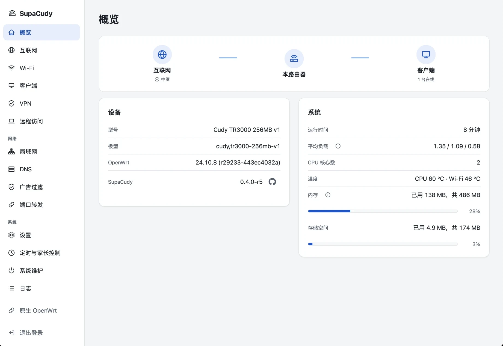

# SupaCudy

[简体中文](README.md) | English

SupaCudy is an OpenWrt 24.10 based firmware for the Cudy TR3000 with a simple, easy-to-use web interface. LuCI remains available.

## Features

- Internet: Ethernet WAN, Wi-Fi repeater (including enterprise Wi-Fi), USB tethering, automatic failover between uplinks
- Wi-Fi: main and guest networks, one network for both bands, QR code sharing
- Clients: device list, speed limits, blocking, fixed IP addresses, parental controls
- VPN client: WireGuard and OpenVPN, per device or per website routing
- DNS: encrypted DNS, ad blocking with AdGuard Home
- Remote access: Tailscale
- Security: one admin password for every login, login protection, WAN access control
- System: temperature, CPU limit, schedules, port forwarding, DDNS, rescue mode, firmware upgrade
- Interface: phone and desktop layouts, English and Simplified Chinese, light and dark themes

## Status

Usable on the router, but under active development; settings and defaults may still change.

- Every commit runs unit, UI, package and full-system emulator tests.
- Runs on a real TR3000. Some items that can only be checked on hardware (such as enterprise Wi-Fi and USB tethering) are not fully tested yet.

## Supported devices

| Device | Build profile | OpenWrt |
|---|---|---|
| Cudy TR3000 v1 (256MB flash) | `cudy-tr3000-256mb-v1` | 24.10.8 |

The 128MB flash version is not supported; images for the two are not interchangeable.

## Installation

The full steps, backups and recovery are in [docs/hardware/flashing-tr3000.md](docs/hardware/flashing-tr3000.md) (Chinese). In short: stock firmware → Cudy's OpenWrt bridge firmware → back up the partitions → flash SupaCudy without keeping settings.

After flashing:

- Join the open Wi-Fi network "SupaCudy", or connect a cable to the LAN port.
- Open <http://192.168.200.1/>, log in as `root` / `supacudy` and follow the setup wizard to set a new admin password and Wi-Fi.
- LuCI is at <http://192.168.200.1/cgi-bin/luci/>.

Flashing third-party firmware can brick the device or void its warranty. Read the flashing guide first.

## Documentation

The documentation is in Chinese.

- [Flashing and recovery](docs/hardware/flashing-tr3000.md)
- [Development guide](docs/development.md): building the firmware, the emulator, tests and debugging
- [Architecture](docs/architecture.md)
- [Roadmap](docs/roadmap.md)
- [Contributing](CONTRIBUTING.md)

## Disclaimer

- Flashing third-party firmware is risky. Back up your important data before you start. You use this project at your own risk: the authors and contributors are not liable for any consequences, including but not limited to data loss, a damaged or unbootable device, or a voided warranty.
- This project is for technical exchange and learning only and must not be used for any illegal purpose. You are responsible for complying with the laws and regulations where you live, including those on radio equipment, network security and data protection.
- SupaCudy is an independent community project. It is not affiliated with or endorsed by Cudy, GL.iNet or the OpenWrt project. Names and trademarks belong to their respective owners.

## License

[Apache-2.0](LICENSE). OpenWrt and the packages included in the firmware are under their own licenses.
